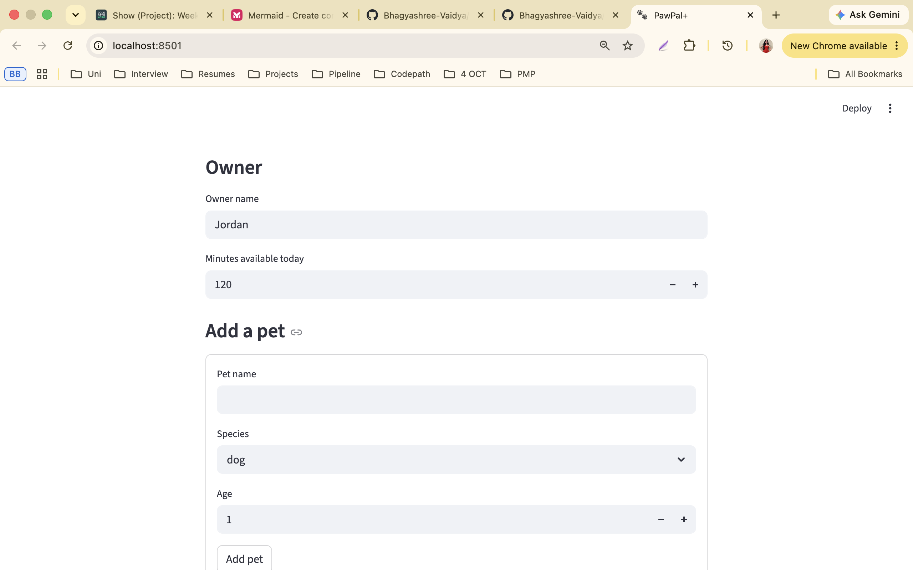
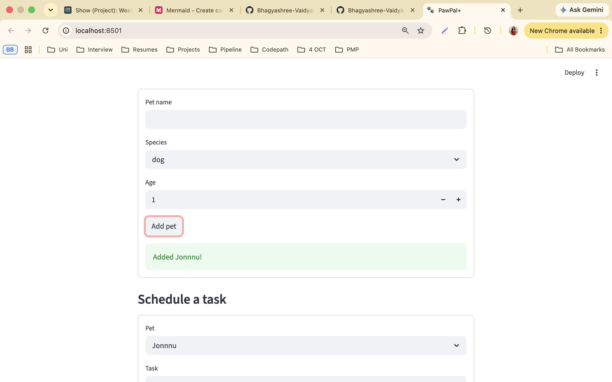
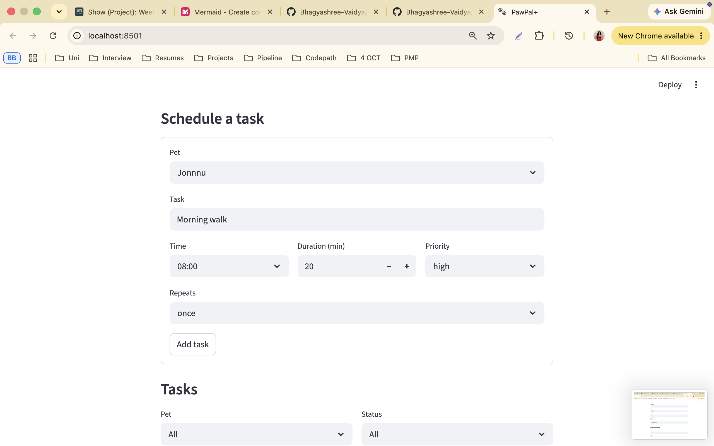
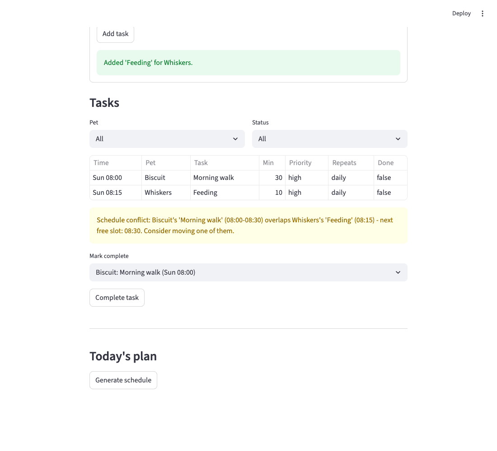
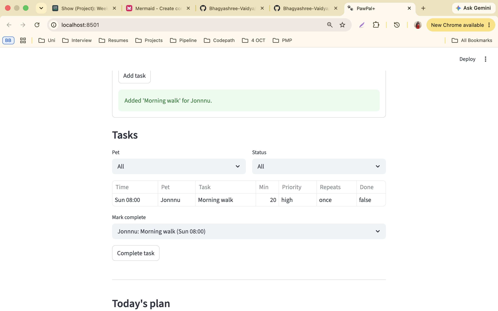
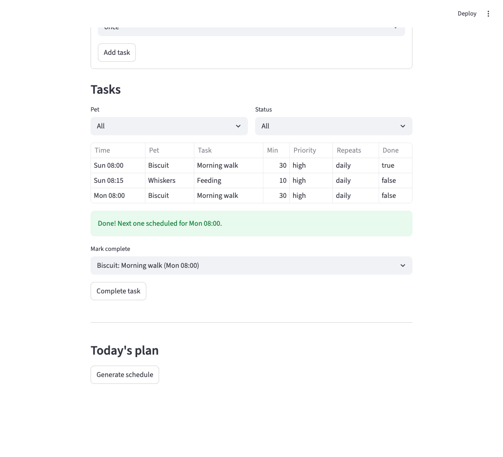
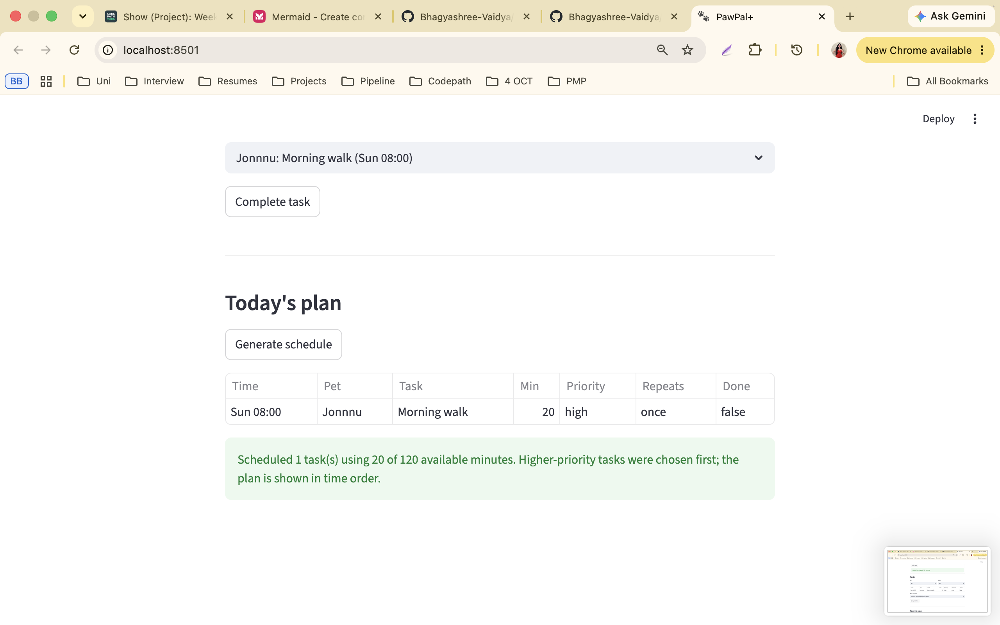

# PawPal+ (Module 2 Project)

You are building **PawPal+**, a Streamlit app that helps a pet owner plan care tasks for their pet.

## Scenario

A busy pet owner needs help staying consistent with pet care. They want an assistant that can:

- Track pet care tasks (walks, feeding, meds, enrichment, grooming, etc.)
- Consider constraints (time available, priority, owner preferences)
- Produce a daily plan and explain why it chose that plan

Your job is to design the system first (UML), then implement the logic in Python, then connect it to the Streamlit UI.

## What you will build

Your final app should:

- Let a user enter basic owner + pet info
- Let a user add/edit tasks (duration + priority at minimum)
- Generate a daily schedule/plan based on constraints and priorities
- Display the plan clearly (and ideally explain the reasoning)
- Include tests for the most important scheduling behaviors

## Getting started

### Setup

```bash
python -m venv .venv
source .venv/bin/activate  # Windows: .venv\Scripts\activate
pip install -r requirements.txt
```

### Suggested workflow

1. Read the scenario carefully and identify requirements and edge cases.
2. Draft a UML diagram (classes, attributes, methods, relationships).
3. Convert UML into Python class stubs (no logic yet).
4. Implement scheduling logic in small increments.
5. Add tests to verify key behaviors.
6. Connect your logic to the Streamlit UI in `app.py`.
7. Refine UML so it matches what you actually built.

## Extras (stretch features)

- **Next available slot** — `Scheduler.find_next_slot`; used by `conflict_warnings` to suggest where a clashing task could go (shown in the CLI output and the UI warning).
- **Data persistence** — `Task/Pet.to_dict` / `from_dict`, `Owner.save(path)` and `Owner.load(path)` write and read `data.json` (git-ignored). `app.py` loads it at startup and saves after every change. A missing or corrupt file falls back to a fresh owner. Files modified: `pawpal_system.py`, `app.py`, `.gitignore`.
- **Formatting** — `main.py` uses the `tabulate` library (`rounded_outline` tables) plus emoji for priority and status.
- **AI log** — see [ai_interactions.md](ai_interactions.md).

## Implementation summary

All logic is in [pawpal_system.py](pawpal_system.py):

- `Task` (dataclass): description, due time, duration, priority, frequency, completion status.
- `Pet` (dataclass): details plus its list of tasks.
- `Owner` (dataclass): holds pets; `get_all_tasks()` returns every pet's tasks together.
- `Scheduler`: reads tasks through `Owner.get_all_tasks()` so it works across all pets (sorting, filtering, conflicts, recurrence, daily plan).

Run the demo with `python3 main.py`, the tests with `python3 -m pytest`, and the UI with `python3 -m streamlit run app.py`.

## Features

- **Sorting by time** across all pets (`Scheduler.sort_by_time`)
- **Filtering** by pet and/or status (`Scheduler.filter_tasks`)
- **Conflict warnings** for overlapping tasks, same or different pets (`Scheduler.conflict_warnings`)
- **Daily/weekly recurrence**: completing a task creates the next one (`Scheduler.complete_task`)
- **Daily plan** by priority within the owner's time budget, with an explanation (`build_daily_plan`, `explain_plan`)
- **Next available slot** (`Scheduler.find_next_slot`): earliest gap that fits a task without overlapping anything; conflict warnings include it
- **JSON persistence** (`Owner.save` / `Owner.load`): pets and tasks survive restarts
- **Formatted output**: `tabulate` tables, emoji priorities and ⚠️ warnings in the CLI
- **Streamlit UI** that keeps the Owner in `st.session_state` and shows these features

## 🖥️ Sample Output

Output of `python3 main.py`:

```

All tasks, sorted by time
╭────┬────────┬──────────┬──────────────┬──────────┬────────────╮
│    │ Time   │ Pet      │ Task         │ Length   │ Priority   │
├────┼────────┼──────────┼──────────────┼──────────┼────────────┤
│ ⬜  │ 08:00  │ Biscuit  │ Morning walk │ 30 min   │ 🔴 high     │
│ ⬜  │ 08:15  │ Whiskers │ Feeding      │ 10 min   │ 🔴 high     │
│ ⬜  │ 14:00  │ Whiskers │ Grooming     │ 60 min   │ 🟢 low      │
│ ⬜  │ 18:00  │ Biscuit  │ Evening walk │ 30 min   │ 🟡 medium   │
╰────┴────────┴──────────┴──────────────┴──────────┴────────────╯

Today's Schedule for Jordan
╭────┬────────┬──────────┬──────────────┬──────────┬────────────╮
│    │ Time   │ Pet      │ Task         │ Length   │ Priority   │
├────┼────────┼──────────┼──────────────┼──────────┼────────────┤
│ ⬜  │ 08:00  │ Biscuit  │ Morning walk │ 30 min   │ 🔴 high     │
│ ⬜  │ 08:15  │ Whiskers │ Feeding      │ 10 min   │ 🔴 high     │
│ ⬜  │ 18:00  │ Biscuit  │ Evening walk │ 30 min   │ 🟡 medium   │
╰────┴────────┴──────────┴──────────────┴──────────┴────────────╯
Scheduled 3 task(s) using 70 of 90 available minutes. Higher-priority tasks were chosen first; the plan is shown in time order.

Whiskers only
╭────┬────────┬──────────┬──────────┬──────────┬────────────╮
│    │ Time   │ Pet      │ Task     │ Length   │ Priority   │
├────┼────────┼──────────┼──────────┼──────────┼────────────┤
│ ⬜  │ 08:15  │ Whiskers │ Feeding  │ 10 min   │ 🔴 high     │
│ ⬜  │ 14:00  │ Whiskers │ Grooming │ 60 min   │ 🟢 low      │
╰────┴────────┴──────────┴──────────┴──────────┴────────────╯

Conflicts:
  ⚠️  Biscuit's 'Morning walk' (08:00-08:30) overlaps Whiskers's 'Feeding' (08:15) - next free slot: 08:30

Next free 30-minute slot from 08:00: 08:30

Completed 'Morning walk'; next one scheduled for Mon 08:00
```

## 🧪 Testing PawPal+

```bash
# Run the full test suite:
python3 -m pytest

# Run with coverage (needs pytest-cov):
python3 -m pytest --cov
```

Sample test output:

```
============================= test session starts ==============================
collecting ... collected 16 items

tests/test_pawpal.py::test_mark_complete_changes_status PASSED           [  6%]
tests/test_pawpal.py::test_add_task_increases_count PASSED               [ 12%]
tests/test_pawpal.py::test_sort_by_time_across_pets PASSED               [ 18%]
tests/test_pawpal.py::test_filter_by_pet_and_status PASSED               [ 25%]
tests/test_pawpal.py::test_conflict_detected_across_pets PASSED          [ 31%]
tests/test_pawpal.py::test_daily_recurrence_creates_next_task PASSED     [ 37%]
tests/test_pawpal.py::test_plan_respects_time_budget_and_priority PASSED [ 43%]
tests/test_pawpal.py::test_pet_with_no_tasks_and_empty_scheduler PASSED  [ 50%]
tests/test_pawpal.py::test_identical_times_flagged_with_warning PASSED   [ 56%]
tests/test_pawpal.py::test_back_to_back_tasks_do_not_conflict PASSED     [ 62%]
tests/test_pawpal.py::test_weekly_recurrence_and_one_off_task PASSED     [ 68%]
tests/test_pawpal.py::test_find_next_slot_skips_busy_blocks PASSED       [ 75%]
tests/test_pawpal.py::test_find_next_slot_none_when_day_full PASSED      [ 81%]
tests/test_pawpal.py::test_conflict_warning_suggests_slot PASSED         [ 87%]
tests/test_pawpal.py::test_save_and_load_round_trip PASSED               [ 93%]
tests/test_pawpal.py::test_load_missing_or_corrupt_file_returns_default PASSED [100%]

============================== 16 passed in 0.03s ==============================
```

Coverage: task completion, adding tasks, sorting and filtering across pets, conflict detection (overlap, identical times, back-to-back), conflict warnings with slot suggestions, next-available-slot search, daily and weekly recurrence, one-off tasks, empty pets, plan priority/time-budget, and JSON save/load (round trip, missing and corrupt files).

**Confidence level: ★★★★☆ (4/5)** — core behaviors and edge cases pass; 16/16 tests pass; untested: tasks crossing midnight, invalid priorities, and recurring-task catch-up for missed days.

## 📐 Smarter Scheduling

| Feature | Method(s) | Notes |
|---------|-----------|-------|
| Task sorting | `Scheduler.sort_by_time` | Orders tasks from all pets by due time |
| Filtering | `Scheduler.filter_tasks` | By pet name and/or completion status |
| Conflict handling | `Scheduler.detect_conflicts`, `conflict_warnings` | Reports overlapping time windows (start < previous end), including across pets; returns warning strings instead of raising |
| Recurring tasks | `Scheduler.complete_task`, `Task.next_occurrence` | Completing a daily/weekly task adds the next one |
| Next available slot | `Scheduler.find_next_slot` | Walks pending tasks in time order and returns the first gap that fits; `None` if it would run past 22:00 |
| Daily plan | `Scheduler.build_daily_plan`, `explain_plan` | Picks by priority within the owner's time budget, shown in time order |

## 📸 Demo Walkthrough

The Streamlit app (`python3 -m streamlit run app.py`) lets you set the owner's daily time budget, add pets, schedule tasks, filter and sort them, mark them complete, and generate today's plan.

Example workflow:

1. Add a pet (e.g. Biscuit, dog) — this creates a `Pet` stored on the `Owner` in `st.session_state`.

   

   

2. Add a pet task (e.g. "Morning walk", 08:00, 30 min, high, daily) via the task form.

   

3. Add a second task for another pet at an overlapping time — the app shows a conflict warning with a suggested free slot.

   
4. View the task table, sorted by time; filter by pet or status.

   

5. Click "Complete task" on a daily task — the next day's copy appears automatically.

   

6. Click "Generate schedule" to see today's plan and why it was chosen.

   


Key Scheduler behaviors shown: sorting, filtering, conflict warnings, recurrence, and priority/time-budget planning. The CLI equivalent is the `main.py` output above.

## ⏱️ Time spent (~4 hours)

| Phase | Time | What I did |
|-------|------|-----------|
| Planning and requirements | 20 min | Read the scenario and rubric, chose the three core actions, listed edge cases |
| UML design | 25 min | Brainstormed attributes/methods, drafted and reviewed the Mermaid diagram |
| Core classes | 40 min | Dataclasses for `Task`/`Pet`/`Owner`, the `Scheduler`, `main.py` demo |
| Algorithms | 40 min | Sorting, filtering, overlap-based conflict detection, recurrence, daily plan |
| Tests | 30 min | Happy paths and edge cases, debugging until green |
| Streamlit UI | 40 min | `session_state` wiring, forms, tables, warnings; fixed the complete-task bug found while testing |
| Stretch features | 30 min | Next-slot search, JSON persistence, `tabulate` output |
| Docs, screenshots, reflection | 35 min | README, UML final, screenshots, AI log, reflection |
| **Total** | **~4 h** | Includes planning, designing, executing, and verifying |

*Times are approximate.*
